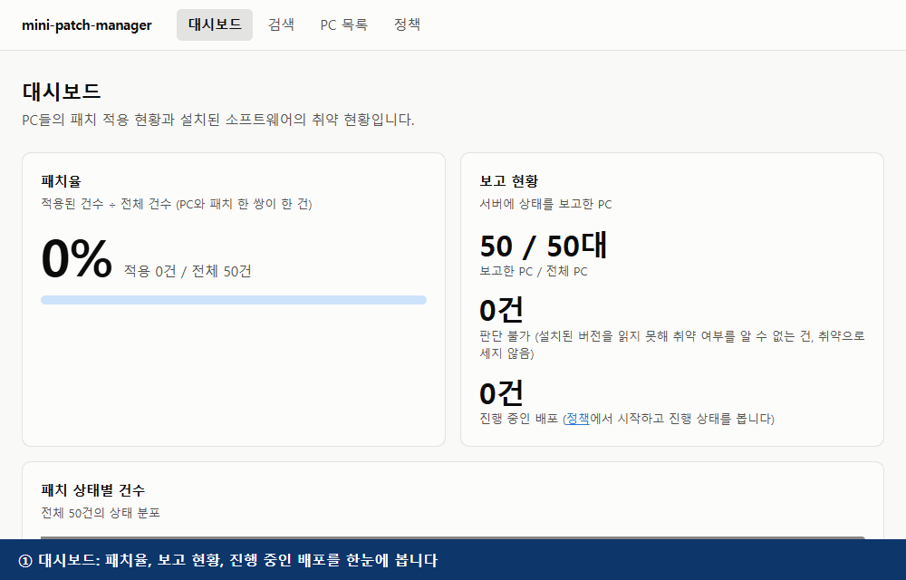
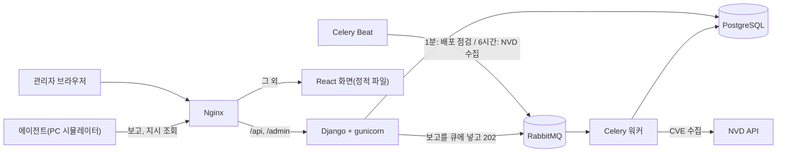
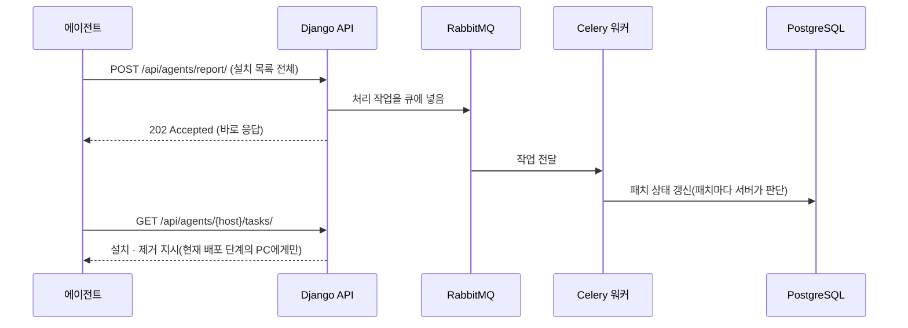
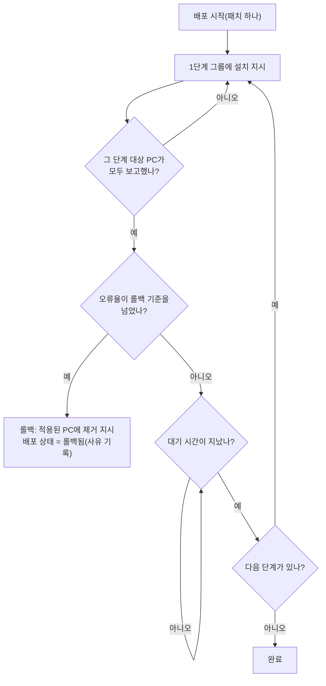

# mini-patch-manager

[](https://github.com/eunbel22/mini-patch-manager/actions/workflows/ci.yml)

PC 여러 대의 소프트웨어와 패치 적용 상태를 모아 보여 주고, 정책에 따라 **단계적으로 배포하고 오류가 많으면 자동으로 롤백**하는 미니 패치 관리 시스템입니다. 실제 PC 대신 가상 PC(에이전트 시뮬레이터)로 동작을 시연하는 개인 포트폴리오 프로젝트입니다.



위 화면은 아래 "시연 순서"를 그대로 따라 한 것입니다. 1단계(테스트 그룹)가 끝나면 2단계(일반 그룹)로 넘어가 완료되고, 두 번째 패치는 2단계의 오류율이 롤백 기준을 넘어 자동으로 롤백됩니다.

## 할 수 있는 것

- **취약점 수집**: NVD(미국 국립 취약점 데이터베이스)에서 CVE를 주기적으로 가져와 점수와 영향받는 소프트웨어(버전 범위)를 저장합니다.
- **취약 판단**: PC에 설치된 소프트웨어 버전이 CVE의 영향 범위에 들어가는지 비교합니다. 버전을 읽지 못하면 "판단 불가"로 따로 셉니다(취약으로 세지 않습니다).
- **에이전트 보고**: PC가 설치된 소프트웨어와 KB를 보고하면 서버는 즉시 `202`로 응답하고, 패치 상태 갱신은 Celery가 비동기로 처리합니다.
- **단계적 배포와 자동 롤백**: 정책(테스트 그룹 → 일반 그룹 …)에 따라 현재 단계의 PC에게만 설치 지시가 나가고, 단계의 오류율이 기준을 넘으면 롤백합니다.
- **관리자 화면**: 대시보드, CVE·KB 검색, PC 목록과 상세, 정책 만들기·편집, 배포 시작과 단계별 진행 상태(자동 갱신).

## 구조



백엔드 이미지는 Rocky Linux 9 + Python 3.12 기반이고, API(gunicorn), Celery 워커, Celery Beat, 초기화 작업이 같은 이미지를 명령만 바꿔서 씁니다. Docker Compose 서비스는 7개입니다(db, mq, init, backend, worker, beat, frontend).

### 에이전트 보고가 처리되는 흐름



에이전트는 "지금 이 PC의 전체 상태"만 보고하고, 패치마다 적용 여부를 정하는 것은 서버입니다. 설치 지시는 서버가 밀어 넣지 않고 에이전트가 가져가게(pull) 했습니다. 방화벽 안의 PC가 서버로 먼저 접속하는 방식이 현실적이라고 판단했기 때문입니다.

### 단계적 배포와 롤백 규칙



- 오류율 = 오류가 난 PC ÷ 그 단계 그룹의 전체 대상 PC. 기준과 **같으면** 롤백하지 않고, 넘을 때만 롤백합니다.
- 패치 하나에 진행 중인 배포는 하나만 허용합니다(DB 제약으로 막음).
- 진행 중인 배포가 있는 정책은 단계를 바꾸거나(400) 삭제할(409) 수 없습니다.
- 롤백된 패치를 다시 배포하면 이전의 오류·롤백 상태를 모두 되돌리고 새로 시작합니다.

## 기술 선택 이유

| 선택 | 이유 | 짚어 둘 점 |
| --- | --- | --- |
| Django + DRF | 모델, 마이그레이션, 관리자 화면, 테스트 도구가 기본으로 있어 규칙이 많은 도메인에 맞음. drf-spectacular로 Swagger 문서를 코드에서 자동 생성 | |
| PostgreSQL | 배포 하나에 진행 중 상태를 하나만 허용하는 규칙을 DB 제약(조건부 유니크)으로 막을 수 있음 | |
| Celery + RabbitMQ | 보고를 받는 일과 처리하는 일을 나눠 에이전트를 빨리 풀어 주고, 처리 능력을 API와 따로 늘리기 위함 | 브로커로 RabbitMQ를 고른 것은 지원 공고의 기술 스택에 맞추려는 것이었고, Redis와 성능을 비교해 고른 것은 아닙니다 |
| Celery Beat | 배포 단계 점검(1분)과 NVD 수집(6시간)을 주기 작업으로 돌림 | |
| React + TypeScript + Vite | 화면이 몇 개 안 되고 서버 상태를 자동 갱신하는 정도라 가벼운 구성으로 충분 | |
| Nginx | 화면 정적 파일을 주고 `/api`, `/admin`은 백엔드로 넘김 | |
| Docker Compose | `docker compose up` 한 번으로 7개 서비스가 켜지고, 시연 데이터까지 들어감 | |
| GitHub Actions | 테스트, 린트, 이미지 빌드, 전체 기동 확인을 push와 pull request마다 자동으로 돌림 | |

## 빠른 시작 (Docker)

필요한 것: Docker Desktop (Compose 포함)

```
docker compose up --build
```

- 화면: http://127.0.0.1:8080 (윈도우에서는 `localhost`보다 `127.0.0.1`이 빠릅니다)
- API 문서(Swagger): http://127.0.0.1:8080/api/docs/
- 관리자: http://127.0.0.1:8080/admin/ (계정은 `docker compose exec backend python3.12 manage.py createsuperuser`로 만듭니다)
- RabbitMQ 관리 화면: http://127.0.0.1:15672 (guest / guest)

처음 켜면 `init` 서비스가 한 번 실행되어 DB 표를 만들고 시연 데이터(그룹 3개, 소프트웨어 20종, PC 50대, 정책 1개, 샘플 패치)를 넣고, 알려진 실제 CVE 5개를 NVD에서 가져옵니다. 인터넷이 없으면 CVE 가져오기만 건너뜁니다. 다시 켜도 데이터가 겹치지 않고, `docker compose down`으로 꺼도 DB는 남습니다.

| 명령 | 하는 일 |
| --- | --- |
| `.env`에 `SEED_DEMO=0`을 적고 `docker compose up --build` | 시연 데이터 없이 빈 DB로 시작 (운영체제와 상관없이 같은 방법) |
| `docker compose up -d db mq` | DB와 큐만 켜기 (아래 개발 환경용) |
| `docker compose down -v` | 모두 끄고 DB 데이터도 지우기 |

NVD API 키는 선택입니다. 프로젝트 폴더에 `.env` 파일을 만들고 `NVD_API_KEY=값`을 적으면 compose가 읽습니다(`.env.example` 참고). 키가 없으면 NVD 호출 사이에 6.5초씩 기다립니다.

### 시연 순서: 단계적 배포와 롤백

1. 화면의 **정책**에서 "높음 이상 단계 배포"를 열고, 2단계의 대기 시간이 60분이므로 **편집**에서 0분으로 바꿉니다.
2. **정책 상세**에서 패치(예: KB5044273)를 고르고 **배포 시작**을 누릅니다.
3. 가상 PC들이 서버에 접속해 설치하는 것을 흉내 냅니다. 여러 번 실행하면 화면의 단계가 저절로 넘어갑니다.
   ```
   docker compose exec backend python3.12 manage.py simulate_agents
   ```
4. 롤백을 보려면 설치 실패 확률을 높여서 실행합니다.
   ```
   docker compose exec backend python3.12 manage.py simulate_agents --error-rate 0.8
   ```

## 개발 환경 (직접 실행)

백엔드는 Python 3.12 이상(개발은 3.13)이 필요합니다.

```
docker compose up -d db mq                   # DB와 큐
cd backend
python -m venv .venv
.venv\Scripts\python -m pip install -r requirements.txt
.venv\Scripts\python manage.py migrate
.venv\Scripts\python manage.py seed_demo
.venv\Scripts\python manage.py runserver 127.0.0.1:8000
.venv\Scripts\celery -A config worker -P solo -l info    # 윈도우는 -P solo
.venv\Scripts\celery -A config beat -l info
cd ../frontend
npm install
npm run dev -- --host 127.0.0.1               # http://127.0.0.1:5173
```

테스트: `cd backend` 후 `.venv\Scripts\python manage.py test patchmgr`, 화면은 `npm run build`와 `npm run lint`. 코드 검사: `pip install -r requirements-dev.txt` 후 `python -m ruff check .`

## 성능

에이전트 1,000대가 한꺼번에 보고할 때 Celery 워커 수별 처리량(한 대의 PC에서 잰 값, 설정마다 3회의 중앙값):

| Celery 워커 | 초당 처리 | 접수 응답 p95 |
| --- | --- | --- |
| (Celery 없이) | 59.7건 | 16.0초 |
| 1개 | 24.8건 | 3.7초 |
| 4개 (기본값) | 72.1건 | 4.6초 |
| 16개 | 140.0건 | 6.8초 |

워커를 늘리면 처리량이 늘고(1개에서 16개로 5.6배), 응답은 Celery 없이보다 짧지만, **모든 보고를 다 처리하는 시간은 워커가 적으면 오히려 더 걸립니다.** Celery를 쓰는 이점은 "처리가 더 빨리 끝난다"가 아니라 에이전트를 빨리 풀어 주는 것과 처리 능력을 API와 따로 늘릴 수 있는 것입니다. 방법, 전체 표(워커 2개, 8개 포함), 해석, 한계는 [loadtest/README.md](loadtest/README.md)에 있습니다.

## 트러블슈팅

### 1. 에이전트 보고 50건이 100초 가까이 걸림

서버 로그에 요청이 약 2초 간격으로 찍혔습니다. 처음에는 Celery 큐에 넣는 시간을 의심했지만 재 보니 0.001초였습니다. 구간별로 시간을 재서 원인을 좁히니, 시뮬레이터가 `localhost`로 접속하는 부분이었습니다. 윈도우에서 `localhost`는 먼저 IPv6(`::1`)로 시도하다 거절당하는 데 약 2초가 걸린 뒤 IPv4로 넘어갑니다. 주소를 `127.0.0.1`로 바꿨고, 같은 서버에 3번 요청해 `localhost` 6.37초와 `127.0.0.1` 0.20초로 확인했습니다. 이후 50건 전송은 약 5초, 보고 API 한 건의 응답은 0.076초입니다.

### 2. 롤백된 패치를 다시 배포하면 시작하자마자 또 롤백됨

테스트(`test_a_new_deployment_after_a_rollback_starts_from_scratch`)를 쓰다가 발견했습니다. 이전 배포에서 설치에 실패한 PC의 오류 상태가 그대로 남아 있어서, 새 배포의 1단계 오류율이 시작 즉시 기준을 넘었습니다(대상 2대 중 1대 오류 = 50% > 20%). 새 배포를 시작할 때 이전의 오류·롤백 상태를 미적용으로 되돌리게 고쳤습니다(이미 적용된 PC는 그대로). 롤백처럼 되돌리기 비용이 큰 동작은 "롤백 이후"의 경로를 먼저 시험해야 한다는 것을 배웠습니다.

### 3. 부하 테스트 중 Nginx가 502를 냄

백엔드 컨테이너를 다시 만들면 새 IP를 받는데, Nginx가 시작할 때 주소를 한 번만 찾아 기억해서 옛 주소로 요청을 보냈습니다. 평소 시연에서는 드러나지 않던 설정의 약점이었습니다. Docker 내장 DNS(`resolver 127.0.0.11 valid=10s`)를 쓰고 주소를 변수로 넘기게 바꿔서, 백엔드를 다시 만들어도 요청이 계속 200으로 나가는 것을 확인했습니다([frontend/nginx.conf](frontend/nginx.conf)).

## CI

push와 pull request마다 GitHub Actions([.github/workflows/ci.yml](.github/workflows/ci.yml))가 세 가지를 검사합니다.

- 백엔드: ruff 린트, `manage.py check`, 빠진 마이그레이션 검사, 실제 PostgreSQL에서 테스트 95개 (Python 3.12, 배포 이미지와 같은 버전)
- 화면: 린트, 타입 검사, 빌드
- Docker: 이미지를 만들고 `docker compose up`으로 전체를 켜서 주요 주소가 열리는지 확인

## 프로젝트 구조

```
backend/      Django 프로젝트 (config/ 설정, patchmgr/ 앱: 모델 · API · 배포 규칙 · NVD 수집 · 버전 비교 · 테스트)
frontend/     React + TypeScript 화면, Nginx 설정
loadtest/     Locust 부하 테스트와 결과
docs/         README에 쓰는 시연 GIF
PRD.md        기능, API, ERD, 배포 규칙
docker-compose.yml
```

## 설계 문서

- [PRD.md](PRD.md): 기능, 화면, API, ERD, 에이전트 보고 형식, 버전 비교 규칙, **배포 규칙**
- [frontend/README.md](frontend/README.md): 화면 목록과 구조
- [loadtest/README.md](loadtest/README.md): 부하 테스트 방법과 결과

## 알려진 한계

- 오래 보고하지 않는 PC가 있으면 그 단계가 멈춥니다(시간 제한이 없습니다).
- 정책의 "실행 시각"은 저장만 하고 배포에는 쓰지 않습니다. 실행 주기와 수동 승인도 없습니다.
- 인증이 없습니다(누구나 API를 호출할 수 있습니다). 로컬 시연용입니다.
- Compose의 비밀 값(`DJANGO_SECRET_KEY`의 기본값, DB와 RabbitMQ 계정)은 로컬 시연용입니다. 실제로 배포한다면 바꿔야 합니다.
- 패치 파일 배포(Nginx로 파일을 내려받게 하고 대역폭을 제한하는 것)는 만들지 않았습니다. 설치 지시만 있고 실제 파일 전송은 없습니다.
- 부하 테스트는 에이전트가 한꺼번에 한 번씩 보고하는 경우만 쟀고, 간격을 두고 계속 보고하는 경우와 배포가 진행 중일 때의 부하는 재지 않았습니다.
